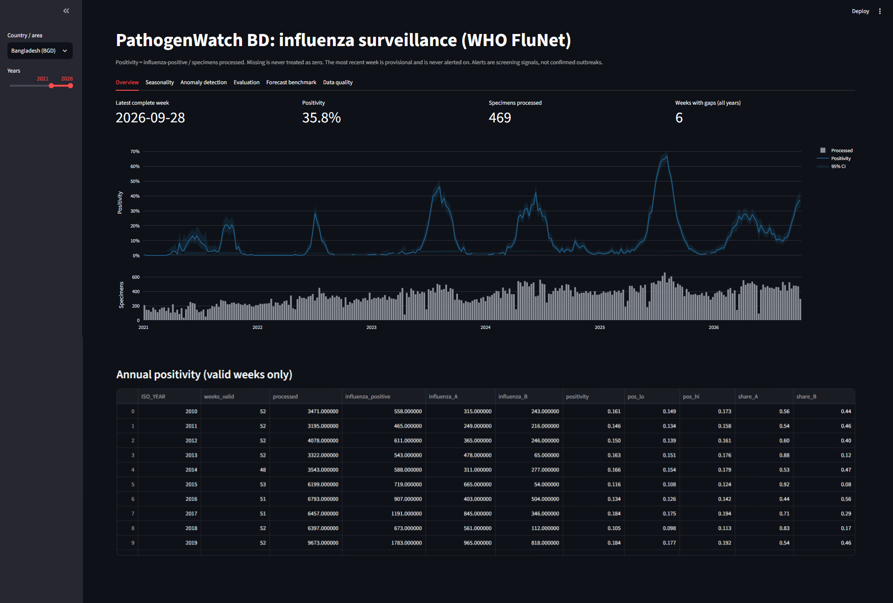
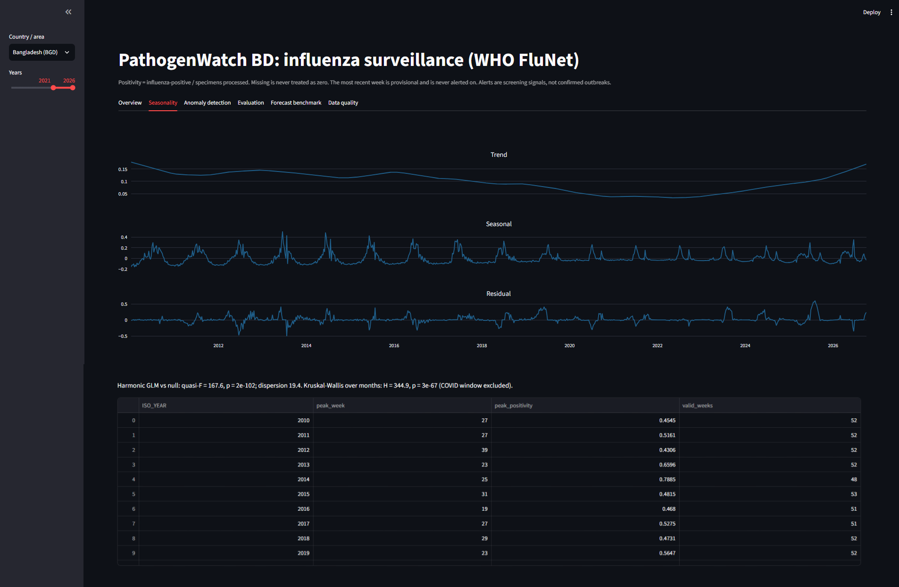
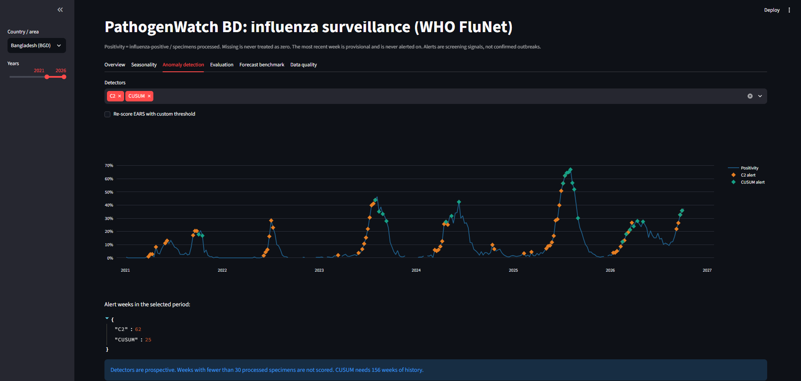
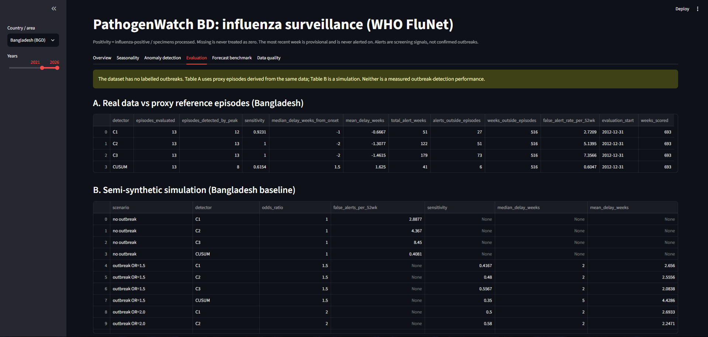
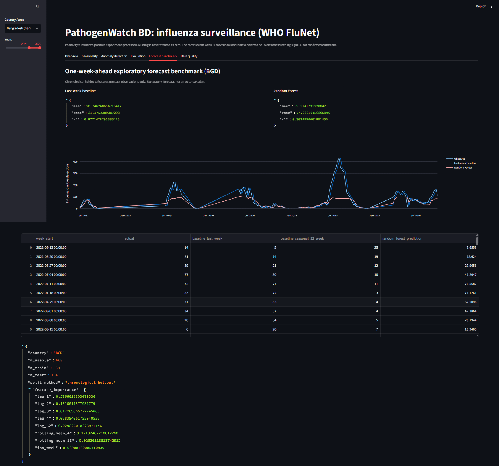
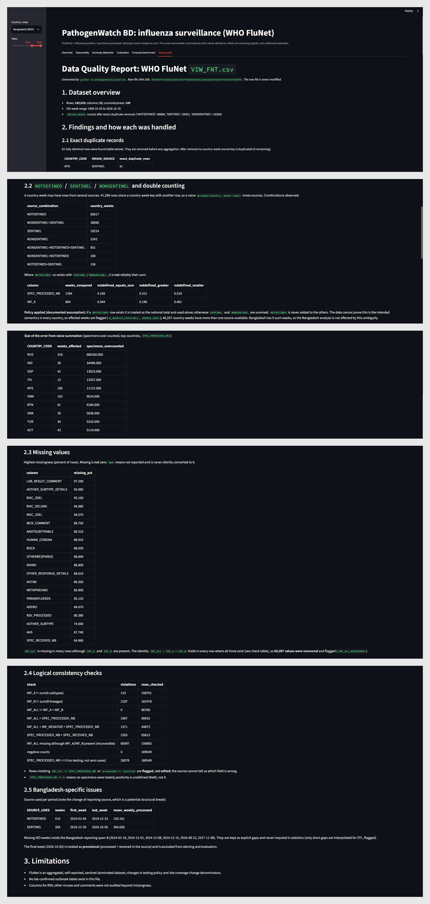
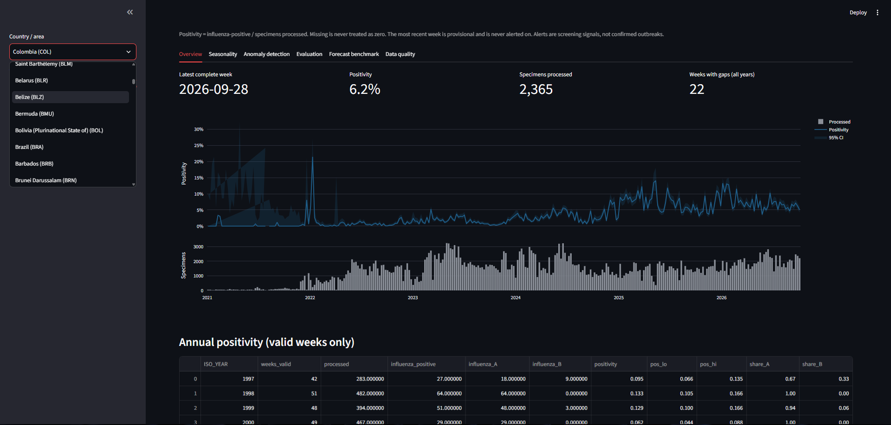
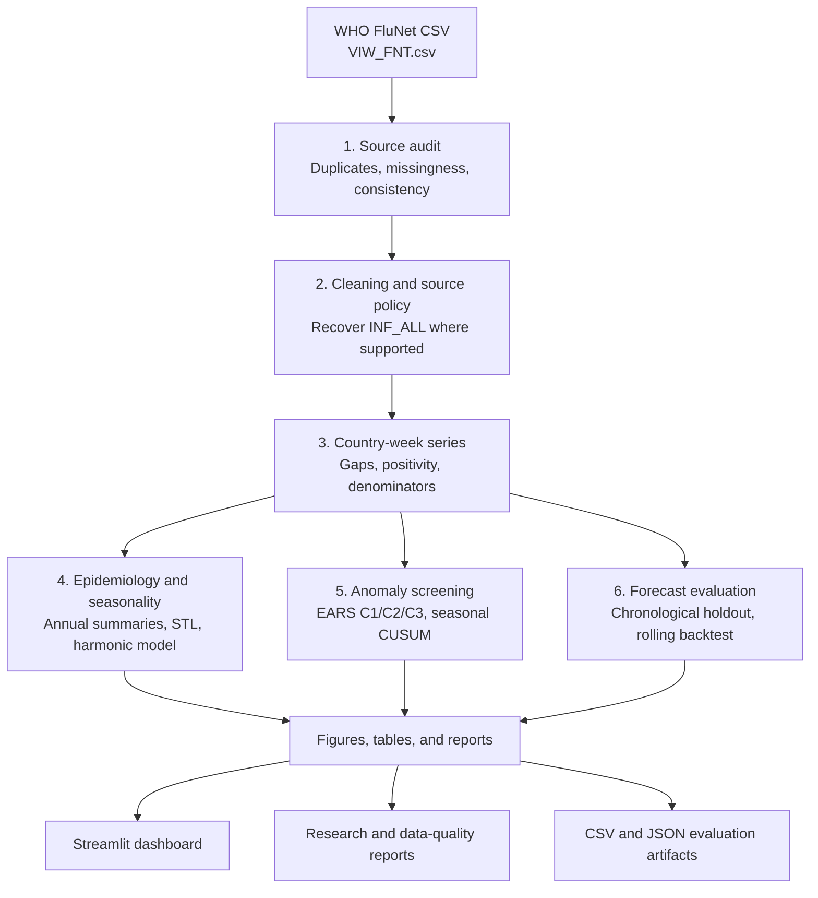

<div align="center">

# 🦠 PathogenWatch BD

### Influenza Surveillance Intelligence Platform

**A reproducible public-health data science workflow for influenza surveillance, seasonality analysis, anomaly screening, and forecast benchmarking.**

[](https://www.python.org/)
[](https://streamlit.io/)
[](https://www.who.int/tools/flunet)
[](https://docs.pytest.org/)
[](#responsible-use-and-limitations)

[Dashboard Tour](#-dashboard-tour) · [Pipeline](#-how-it-works) · [Model Results](#-forecast-benchmark) · [Run Locally](#-run-locally) · [Limitations](#-responsible-use-and-limitations)

</div>

---

## 📌 Overview

**PathogenWatch BD** is an end-to-end public-health data science project that transforms aggregated **WHO FluNet influenza surveillance data** into a reproducible analysis pipeline and an interactive Streamlit dashboard.

The project explores a practical question:

> How can routinely reported surveillance data be audited and analyzed to better understand influenza activity, recurring seasonal patterns, unusual changes, and the performance of exploratory forecasts?

Rather than presenting charts alone, PathogenWatch BD makes the analytical workflow visible, from source-data checks and documented cleaning decisions to epidemiological summaries, prospective anomaly screening, chronological forecasting evaluation, and generated reports.

### What the project includes

- **Data quality auditing:** duplicate detection, missingness checks, source-combination review, and consistency checks.
- **Epidemiological summaries:** weekly and annual positivity, specimen denominators, confidence intervals, and influenza A/B summaries.
- **Seasonality analysis:** robust STL decomposition, harmonic modeling, and calendar-month comparisons.
- **Anomaly screening:** EARS C1/C2/C3 and seasonal-baseline CUSUM.
- **Forecast benchmarking:** simple baselines compared with Random Forest using chronological evaluation.
- **Reproducible outputs:** generated reports, figures, tables, JSON metrics, and automated tests.
- **Interactive exploration:** country/area and year-range filters in a Streamlit dashboard.

> **Scope:** This is a research prototype for retrospective analysis. It is not a clinical tool, a confirmed outbreak detector, or a validated operational early-warning service.

---

## 🖥️ Dashboard Preview



The dashboard brings together surveillance summaries, seasonality, anomaly signals, evaluation results, forecast comparisons, and data-quality findings.

## 🎬 Dashboard Tour

### 1. Overview: influenza activity at a glance

Explore country/area and year-range filters, latest complete-week indicators, weekly positivity with 95% confidence intervals, processed specimen counts, and annual summaries.


### 2. Seasonality: examine recurring patterns

Inspect trend, seasonal and residual components, seasonal test statistics, and annual peak-week summaries.



### 3. Anomaly Detection: review unusual signals

Compare detector signals with weekly positivity. These are screening results that need interpretation, not proof of an outbreak.



### 4. Detector Evaluation: understand evaluation trade-offs

Review proxy-episode evaluation and semi-synthetic simulation results. These approaches answer different questions and should not be interpreted as confirmed outbreak-detection performance.



### 5. Forecast Benchmark: compare predictions with observations

Inspect chronological holdout results, baseline and Random Forest metrics, and saved prediction tables.



### 6. Data Quality: make source decisions visible

Review source combinations, duplicate handling, missing values, consistency checks, and Bangladesh-specific reporting gaps.



### 7. Country Selection: explore available series

Use country/area and year-range controls to inspect other available country-level series. Coverage and interpretability may vary by country.



---

## ⚙️ How It Works

The workflow keeps the original raw CSV unchanged and creates downstream outputs through a sequence of documented steps.



### Pipeline stages

| Stage | Main operations | Key considerations |
|---|---|---|
| **1. Source audit** | Check duplicates, missingness, source combinations, and logical consistency; record the raw-file SHA-256 checksum. | Preserve the raw source and identify potential double counting across `NOTDEFINED`, `SENTINEL`, and `NONSENTINEL` rows. |
| **2. Cleaning and aggregation** | Remove exact duplicates; recover `INF_ALL` only where `INF_A + INF_B` supports the identity; apply the documented source-selection policy. | Avoid blindly summing source rows and keep missing reporting weeks explicit. |
| **3. Epidemiological summaries** | Calculate weekly and annual positivity, 95% Wilson confidence intervals, influenza A/B shares, and peak ISO weeks. | Positivity is undefined when no specimens were processed. |
| **4. Seasonality analysis** | Fit a harmonic quasi-binomial model with two annual harmonics; run robust STL with a 52-week period; compare calendar months with a Kruskal–Wallis test. | The documented COVID-19 window is excluded from seasonal model fitting. |
| **5. Anomaly screening** | Run EARS C1/C2/C3 and seasonal-baseline CUSUM; assess proxy episodes and semi-synthetic scenarios. | Scores use past observations only; proxy episodes and simulations are not confirmed outbreak labels. |
| **6. Forecast evaluation** | Compare last-week and seasonal lag-52 baselines with Random Forest using chronological holdout and rolling one-step-ahead evaluation. | Preserve time order and compare complex models against simple baselines. |
| **7. Reporting** | Generate figures, tables, Markdown reports, CSV predictions, and JSON evaluation artifacts. | Outputs can be inspected in the dashboard and reused for further analysis. |

---

## 📊 Forecast Benchmark

The saved Bangladesh rolling one-step-ahead backtest contains **260 predictions per model**.

### Rolling one-step-ahead backtest

| Model | MAE ↓ | RMSE ↓ | Predictions |
|---|---:|---:|---:|
| **Last-week baseline** | **11.43** | **22.24** | 260 |
| Random Forest | 17.46 | 41.09 | 260 |

### Chronological holdout

| Model | MAE ↓ | RMSE ↓ | R² |
|---|---:|---:|---:|
| **Last-week baseline** | **20.75** | **31.18** | **0.877** |
| Random Forest | 39.31 | 74.23 | 0.304 |

### Interpretation

In the recorded evaluations, the **last-week baseline outperformed Random Forest** on both MAE and RMSE. This is an important result: a more complex model does not necessarily provide better forecasts, and simple baselines should be part of any credible model comparison.

The rolling evaluation is a **rolling one-step-ahead backtest**. As evaluation moves forward, newly observed weeks can become available. It is not a fixed-origin 13-week forecast.

Metrics are specific to the saved evaluation and dataset. They should not be interpreted as evidence of future operational performance.

---

## 🧪 Analytical Methods

| Component | Method | Purpose |
|---|---|---|
| Data quality | Duplicate, missingness, source-combination, and consistency checks | Make source limitations and cleaning decisions explicit |
| Positivity | Positive detections / specimens processed | Track influenza activity while respecting denominators |
| Uncertainty | 95% Wilson confidence intervals | Communicate uncertainty in positivity estimates |
| Trend and seasonality | Harmonic quasi-binomial model; robust STL | Characterize recurring structure |
| Month comparison | Kruskal–Wallis test | Compare distributions across calendar months |
| Anomaly screening | EARS C1/C2/C3; seasonal CUSUM | Flag unusual observations prospectively |
| Detector evaluation | Proxy episodes; semi-synthetic simulation | Examine trade-offs under stated assumptions |
| Forecasting | Last-week, seasonal-naive, and Random Forest models | Compare predictive errors |
| Validation | Automated `pytest` suite | Guard key analytical invariants |

### Core definitions

**Weekly positivity**

\[
\text{Positivity}_t =
\frac{\text{Influenza-positive detections}_t}
{\text{Specimens processed}_t}
\]

When no specimens were processed, positivity is undefined rather than zero.

**Forecast metrics**

- **MAE:** average absolute difference between actual and predicted values.
- **RMSE:** square root of the mean squared prediction error, which gives larger errors more weight.
- **R²:** compares predictions with a mean-based reference. Interpret carefully for time-series holdouts.

---

## 🧰 Technology Stack

| Layer | Tools |
|---|---|
| Language | Python |
| Interactive dashboard | Streamlit |
| Data processing | pandas, NumPy |
| Statistics and time series | SciPy, statsmodels |
| Machine learning | scikit-learn |
| Visualization | Matplotlib, Streamlit charts |
| Testing | pytest |
| Additional analysis | R scripts and a Stata do-file |

Use `pyproject.toml` as the source of truth for Python dependency configuration. The presence of an R script or Stata do-file does not, by itself, mean those tools are required to run the Python dashboard.

---

## 📁 Project Structure

```text
PathogenWatch_BD_Final_Implementation/
├── analysis/
│   ├── run_analysis.R
│   └── run_stata.do
├── app/
│   └── streamlit_app.py
├── data/
│   ├── raw/
│   │   └── VIW_FNT.csv
│   └── processed/
├── reports/
│   ├── figures/
│   ├── tables/
│   ├── research_report.md
│   ├── data_quality_report.md
│   ├── forecast_model_evaluation.json
│   ├── rolling_backtest_evaluation.json
│   └── results.json
├── screenshots/
│   ├── 01_dashboard_overview.png
│   ├── 02_seasonality.png
│   ├── 03_anomaly_detection.png
│   ├── 04_forecasting.png
│   ├── 05_forecast_benchmark.png
│   ├── 06_data_quality.png
│   └── 07_country_selection.png
├── src/
│   └── pathogenwatch/
├── tests/
├── run_pipeline.py
├── pyproject.toml
└── README.md
```

---

## 🚀 Run Locally

### Prerequisites

- Python version compatible with the project's `pyproject.toml`
- Git
- The project source code and required input data

### 1. Clone the repository

```bash
git clone <YOUR_GITHUB_REPOSITORY_URL>
cd PathogenWatch_BD_Final_Implementation
```

Replace `<YOUR_GITHUB_REPOSITORY_URL>` with your actual GitHub repository URL.

### 2. Create and activate a virtual environment

**Windows PowerShell**

```powershell
python -m venv .venv
.\.venv\Scripts\Activate.ps1
```

If PowerShell blocks script activation, follow your local Python environment policy or activate the environment using another supported terminal.

### 3. Install the project

```powershell
python -m pip install --upgrade pip
pip install -e .
```

If editable installation is not configured in `pyproject.toml`, use the dependency installation instructions defined by the repository.

### 4. Generate analysis outputs

```powershell
python run_pipeline.py
```

The pipeline is intended to create or refresh processed data, reports, figures, tables, and forecast evaluation outputs.

### 5. Launch the dashboard

```powershell
python -m streamlit run app/streamlit_app.py
```

Open the local URL printed by Streamlit, typically:

```text
http://localhost:8501
```

### 6. Run the tests

```powershell
python -m pytest -v
```

**Recorded development verification:** 25 tests passed. Re-run the suite after changing code or dependencies.

---

## 📦 Key Generated Outputs

| Artifact | Description |
|---|---|
| `reports/research_report.md` | Main epidemiology, seasonality, anomaly-screening, and forecasting analysis |
| `reports/data_quality_report.md` | Audit findings, cleaning decisions, and reporting limitations |
| `reports/forecast_model_evaluation.json` | Chronological holdout model metrics |
| `reports/rolling_backtest_evaluation.json` | Rolling backtest MAE/RMSE summary |
| `reports/tables/bgd_forecast_holdout.csv` | Holdout observations and model predictions |
| `reports/tables/bgd_rolling_backtest.csv` | Rolling predictions and cutoff dates |
| `reports/tables/bgd_weekly_positivity.csv` | Weekly positivity and specimen denominators |
| `reports/tables/bgd_annual_positivity.csv` | Annual positivity summaries |
| `reports/figures/` | Pipeline-generated analysis figures |
| `reports/results.json` | Summary results and forecast metadata |

---

## ♻️ Reproducibility and Testing

- The raw input is treated as read-only.
- The pipeline records a SHA-256 checksum of the raw input.
- Recorded random seed: `20261020`.
- Tests cover cleaning rules, anomaly-detector behavior, forecasting chronology, and real-data invariants.
- Run `python run_pipeline.py` to regenerate the core reports and figures.
- Run `python -m pytest -v` to check the test suite.

For reproducible comparisons, keep the source data version, environment dependencies, and generated evaluation artifacts together when documenting results.

---

## 🛡️ Responsible Use and Limitations

- **No labelled outbreak ground truth:** sensitivity and detection delay on real outbreaks cannot be measured directly from this dataset.
- **Proxy episodes are not confirmed outbreaks:** results depend on the retrospective episode definition.
- **Simulation results are conditional:** semi-synthetic findings depend on the selected outbreak shapes, noise assumptions, and baseline construction.
- **Surveillance data can shift:** testing volume, sentinel-site coverage, reporting practices, and source transitions can affect observed trends.
- **Forecasting is exploratory:** results are retrospective and dataset-specific; the simple last-week baseline outperformed Random Forest in the recorded evaluations.
- **Latest data may be provisional:** the final reporting week is excluded from alerting and evaluation.
- **Not a clinical or operational alerting service:** results require epidemiological context and external validation before any real-world deployment.

These limitations are part of the interpretation of the results, not just implementation details.

---

## 🗺️ Roadmap

- [ ] Add a reproducible deployment guide for a hosted Streamlit dashboard.
- [ ] Add a versioned data-refresh workflow for future source releases.
- [ ] Compare additional forecasting baselines across multiple rolling-origin designs.
- [ ] Add alert-review feedback when labelled outcomes become available.
- [ ] Improve mobile and accessibility testing.
- [ ] Add continuous integration to run tests on each push.

---

## 📚 Data Source and Attribution

This project analyzes WHO FluNet influenza surveillance data supplied in `VIW_FNT.csv`.

Before publishing or redistributing the raw data, review the original provider's terms, attribution requirements, and redistribution rules. Public availability does not automatically imply permission to redistribute the source file.

---

## 👤 Author

**Md. Sakender Saikot**

---

<div align="center">

**PathogenWatch BD**

*Reproducible analytics for transparent influenza surveillance.*

</div>
