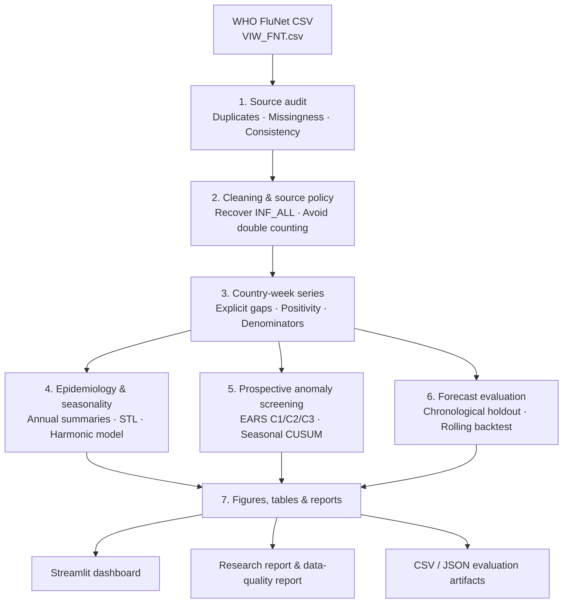

::: {align="center"}
# 🦠 PathogenWatch BD

### Influenza Surveillance Intelligence Platform

**From raw WHO FluNet records to quality-controlled epidemiology,
anomaly screening, and forecast benchmarking.**

```{=html}
<p>
```
``{=html}
```{=html}
</p>
```
```{=html}
<p>
```
``{=html}
``{=html}
``{=html}
``{=html}
``{=html}
``{=html}
```{=html}
</p>
```
[Explore the Dashboard](#-dashboard-tour) · [See the
Pipeline](#-how-the-pipeline-works) · [Results](#-model-benchmark) ·
[Run Locally](#-run-the-project-locally) ·
[Limitations](#-responsible-use--limitations)
:::

------------------------------------------------------------------------

## 🧭 What is PathogenWatch BD?

**PathogenWatch BD** is an end-to-end public-health data science project
that transforms aggregated **WHO FluNet influenza surveillance data**
into a reproducible analysis workflow and an interactive dashboard.

It is designed around one practical question:

> **How can we turn imperfect, routinely reported surveillance data into
> transparent evidence about influenza activity, seasonality, unusual
> changes, and exploratory forecasts?**

Instead of treating a chart as the whole project, PathogenWatch BD
covers the workflow behind it: source auditing, careful cleaning,
country-week aggregation, epidemiological summaries, statistical
seasonality analysis, prospective anomaly screening, chronological
forecasting evaluation, report generation, and dashboard exploration.

::: {align="center"}
  --------------------------------------------------------------------------
     🧹 Data           📈       🔁 Seasonality   🚨 Anomaly    🔮 Forecast
     quality      Epidemiology                   screening      benchmark
  -------------- -------------- -------------- -------------- --------------
  Audit & clean      Track        Decompose       Compare      Test against
                   positivity      patterns      detectors      baselines

  --------------------------------------------------------------------------
:::

## 🎬 How the pipeline works

The project can be understood as a sequence of data products. Each stage
produces outputs used by the next stage, while the original raw CSV
remains unchanged.



### Pipeline stages at a glance

```{=html}
<details>
```
```{=html}
<summary>
```
`<strong>`{=html}01 · Audit the source`</strong>`{=html}
```{=html}
</summary>
```
-   Inspect duplicate records, missingness, source combinations, and
    logical consistency.
-   Record the raw file SHA-256 checksum.
-   Preserve the raw source file; cleaning is performed downstream.
-   Identify where `NOTDEFINED`, `SENTINEL`, and `NONSENTINEL` rows
    could lead to double counting.

```{=html}
</details>
```
```{=html}
<details>
```
```{=html}
<summary>
```
`<strong>`{=html}02 · Clean and aggregate carefully`</strong>`{=html}
```{=html}
</summary>
```
-   Remove exact duplicates before aggregation.
-   Recover `INF_ALL` only where `INF_A + INF_B` supports the identity.
-   Apply the documented source-selection policy rather than blindly
    summing all source rows.
-   Keep missing reporting weeks explicit.
-   Treat positivity as undefined when no specimens were processed.

```{=html}
</details>
```
```{=html}
<details>
```
```{=html}
<summary>
```
`<strong>`{=html}03 · Describe influenza activity`</strong>`{=html}
```{=html}
</summary>
```
-   Build weekly and annual positivity summaries.
-   Calculate 95% Wilson confidence intervals.
-   Compare influenza A/B shares and reported subtype/lineage
    detections.
-   Inspect peak ISO weeks and changes in processed specimen volume.

```{=html}
</details>
```
```{=html}
<details>
```
```{=html}
<summary>
```
`<strong>`{=html}04 · Characterize seasonality`</strong>`{=html}
```{=html}
</summary>
```
-   Fit a harmonic quasi-binomial model with two annual harmonics.
-   Produce robust STL components with a 52-week period.
-   Compare calendar-month distributions with a Kruskal--Wallis test.
-   Exclude the documented COVID-19 window from seasonal model fitting.

```{=html}
</details>
```
```{=html}
<details>
```
```{=html}
<summary>
```
`<strong>`{=html}05 · Screen for unusual activity`</strong>`{=html}
```{=html}
</summary>
```
-   Run EARS C1, C2, and C3 detectors.
-   Run a seasonal-baseline CUSUM.
-   Score prospectively using past observations only.
-   Compare real-data alerts with proxy reference episodes and evaluate
    semi-synthetic scenarios.

```{=html}
</details>
```
```{=html}
<details>
```
```{=html}
<summary>
```
`<strong>`{=html}06 · Benchmark forecasts`</strong>`{=html}
```{=html}
</summary>
```
-   Use chronological holdout evaluation rather than random splitting.
-   Compare a last-week baseline and seasonal lag-52 baseline with
    Random Forest.
-   Save actual values and predictions to CSV.
-   Evaluate rolling one-step-ahead predictions over successive 13-week
    blocks.

```{=html}
</details>
```
```{=html}
<details>
```
```{=html}
<summary>
```
`<strong>`{=html}07 · Deliver reproducible outputs`</strong>`{=html}
```{=html}
</summary>
```
-   Generate report tables and figures.
-   Write `research_report.md` and `data_quality_report.md`.
-   Save forecast metrics as JSON and predictions as CSV.
-   Explore the generated results in the Streamlit dashboard.

```{=html}
</details>
```
## 🖥️ Dashboard tour

The dashboard is organized into six views. The screenshots below should
match the filenames in your repository's `screenshots/` directory.

### 1. Overview --- current activity and long-term context

Country selection, year-range filtering, latest complete-week
indicators, weekly positivity with a 95% confidence interval, processed
specimen counts, and annual positivity summaries.


### 2. Seasonality --- reveal recurring patterns

Explore the trend, seasonal component, residual component, seasonal test
statistics, and annual peak-week summaries.


### 3. Anomaly detection --- inspect alert signals

Select detectors and inspect alert markers against the weekly positivity
series. Alerts are screening signals that require interpretation, not
proof of an outbreak.


### 4. Evaluation --- understand detector trade-offs

Compare proxy-episode evaluation and semi-synthetic simulation results.
These two evaluation designs answer different questions and should not
be interpreted as labelled outbreak performance.


### 5. Forecast benchmark --- compare predictions with observations

Inspect the chronological holdout plot, baseline and Random Forest
metrics, and the saved prediction table.


### 6. Data quality --- make data decisions visible

Review source combinations, duplicate handling, missing values,
consistency checks, and Bangladesh-specific reporting gaps.


### Interactive country selection

Country/area and year-range controls let users explore other available
country-level series. Data coverage and interpretability vary by
country.


## 📊 Model benchmark

The saved Bangladesh rolling one-step-ahead backtest contains **260
predictions per model**.

### Rolling backtest

  Model                      MAE ↓      RMSE ↓   Predictions
  -------------------- ----------- ----------- -------------
  Last-week baseline     **11.43**   **22.24**           260
  Random Forest              17.46       41.09           260

### Chronological holdout

  Model                      MAE ↓      RMSE ↓          R²
  -------------------- ----------- ----------- -----------
  Last-week baseline     **20.75**   **31.18**   **0.877**
  Random Forest              39.31       74.23       0.304

**What this means:** the last-week baseline outperformed Random Forest
in both reported evaluations. The project does not claim that a more
complex model is automatically better. Baselines are essential, and
model choice should be driven by measured performance.

The rolling test is a **rolling one-step-ahead evaluation**: newly
observed weeks can become available as the evaluation moves forward. It
is not a fixed-origin 13-week forecast.

## 🧪 Analytical methods

  -----------------------------------------------------------------------
  Component               Method                  Purpose
  ----------------------- ----------------------- -----------------------
  Data audit              Duplicate, missingness, Make source limitations
                          source-combination, and explicit
                          consistency checks      

  Positivity              Positive detections /   Track activity while
                          specimens processed     respecting denominators

  Uncertainty             95% Wilson intervals    Communicate uncertainty
                                                  in positivity estimates

  Trend and seasonality   Harmonic quasi-binomial Characterize recurring
                          model; robust STL       structure

  Month comparison        Kruskal--Wallis test    Test differences across
                                                  calendar months

  Anomaly screening       EARS C1/C2/C3; seasonal Identify unusual
                          CUSUM                   observations
                                                  prospectively

  Detector evaluation     Proxy episodes;         Examine trade-offs
                          semi-synthetic          under stated
                          simulation              assumptions

  Forecasting             Last-week,              Compare predictive
                          seasonal-naive, Random  errors
                          Forest                  

  Validation              Automated pytest suite  Guard key analytical
                                                  invariants
  -----------------------------------------------------------------------

### Core definitions

**Weekly positivity**

\[ `\text{Positivity}`{=tex}\_t =
`\frac{\text{Influenza-positive detections}_t}`{=tex}
{`\text{Specimens processed}`{=tex}\_t} \]

If no specimens were processed, positivity is undefined, not zero.

**Forecast error metrics**

-   **MAE:** average absolute difference between actual and predicted
    values.
-   **RMSE:** square root of mean squared prediction error; larger
    errors receive more weight.
-   **R²:** comparison with a mean-based reference; interpret carefully
    for time-series holdouts.

## 🧰 Technology stack

::: {align="center"}
  Layer                 Tools
  --------------------- -----------------------------------
  Language              Python
  Dashboard             Streamlit
  Data processing       pandas, NumPy
  Statistics            SciPy, statsmodels
  Machine learning      scikit-learn
  Visualization         Matplotlib and Streamlit charts
  Testing               pytest
  Additional analysis   R scripts; Stata do-file included
:::

Use `pyproject.toml` as the source of truth for Python dependency
configuration. The presence of an R script or Stata do-file does not, by
itself, mean those tools are required to run the Python dashboard.

## 📁 Project structure

``` text
PathogenWatch_BD_Final_Implementation/
├── analysis/
│   ├── run_analysis.R
│   └── run_stata.do
├── app/
│   └── streamlit_app.py
├── data/
│   ├── raw/
│   │   └── VIW_FNT.csv
│   └── processed/
├── reports/
│   ├── figures/
│   ├── tables/
│   ├── research_report.md
│   ├── data_quality_report.md
│   ├── forecast_model_evaluation.json
│   ├── rolling_backtest_evaluation.json
│   └── results.json
├── screenshots/
│   ├── 01_dashboard_overview.png
│   ├── 02_seasonality.png
│   ├── 03_anomaly_detection.png
│   ├── 04_forecasting.png
│   ├── 05_forecast_benchmark.png
│   ├── 06_data_quality.png
│   └── 07_country_selection.png
├── src/
│   └── pathogenwatch/
├── tests/
├── run_pipeline.py
├── pyproject.toml
└── README.md
```

## ⚡ Run the project locally

### 1. Clone your repository

``` bash
git clone <YOUR_GITHUB_REPOSITORY_URL>
cd PathogenWatch_BD_Final_Implementation
```

Replace `<YOUR_GITHUB_REPOSITORY_URL>` with the URL of your GitHub
repository.

### 2. Create a virtual environment

**Windows PowerShell**

``` powershell
python -m venv .venv
.\.venv\Scripts\Activate.ps1
```

### 3. Install the project

``` powershell
python -m pip install --upgrade pip
pip install -e .
```

If editable installation is not configured in `pyproject.toml`, follow
the dependency installation instructions defined by the repository.

### 4. Generate the analysis outputs

``` powershell
python run_pipeline.py
```

The pipeline creates or refreshes processed data, reports, figures,
tables, and forecast evaluation outputs.

### 5. Launch the dashboard

``` powershell
python -m streamlit run app/streamlit_app.py
```

Open the local address printed by Streamlit, typically:

``` text
http://localhost:8501
```

### 6. Run the tests

``` powershell
python -m pytest -v
```

**Development verification:** 25 tests passed in the recorded run.
Re-run the suite after changing code or dependencies.

## 📦 Key generated outputs

  --------------------------------------------------------------------------------
  Artifact                                     What it contains
  -------------------------------------------- -----------------------------------
  `reports/research_report.md`                 Main epidemiology, seasonality,
                                               anomaly-detection, and forecasting
                                               analysis

  `reports/data_quality_report.md`             Audit findings, cleaning decisions,
                                               and reporting limitations

  `reports/forecast_model_evaluation.json`     Chronological holdout model metrics

  `reports/rolling_backtest_evaluation.json`   Rolling backtest MAE/RMSE summary

  `reports/tables/bgd_forecast_holdout.csv`    Holdout observations and model
                                               predictions

  `reports/tables/bgd_rolling_backtest.csv`    Rolling predictions and cutoff
                                               dates

  `reports/tables/bgd_weekly_positivity.csv`   Weekly positivity and associated
                                               denominators

  `reports/tables/bgd_annual_positivity.csv`   Annual positivity summaries

  `reports/figures/`                           Pipeline-generated analysis figures

  `reports/results.json`                       Summary results and forecast
                                               metadata
  --------------------------------------------------------------------------------

## 🛡️ Responsible use and limitations

-   **No labelled outbreak ground truth:** real-data sensitivity and
    detection delay cannot be measured directly from this dataset.
-   **Proxy episodes are not confirmed outbreaks:** results depend on
    the retrospective episode definition.
-   **Simulation is conditional:** semi-synthetic results reflect the
    chosen outbreak shapes, noise assumptions, and baseline
    construction.
-   **Surveillance data can shift:** testing volume, sentinel-site
    coverage, reporting practices, and source transitions can affect the
    observed series.
-   **Forecasting is exploratory:** results are retrospective and
    dataset-specific; the simple baseline performed better than Random
    Forest here.
-   **Latest data can be provisional:** the final reporting week is
    excluded from alerting and evaluation.
-   **Not a clinical or operational alerting service:** outputs need
    epidemiological context and external validation before real-world
    deployment.

## ♻️ Reproducibility

-   The raw input is treated as read-only.
-   The pipeline records a SHA-256 checksum.
-   Random seed: `20261020`.
-   Tests cover cleaning rules, anomaly detection behaviour, forecasting
    chronology, and real-data invariants.
-   Run `python run_pipeline.py` to regenerate the core reports and
    figures.

## 🗺️ Roadmap

-   [ ] Add a reproducible deployment guide for a hosted Streamlit
    dashboard.
-   [ ] Add a versioned data-refresh workflow for future source
    releases.
-   [ ] Compare additional forecasting baselines with multiple
    rolling-origin designs.
-   [ ] Add alert-review feedback when labelled outcomes become
    available.
-   [ ] Improve mobile and accessibility testing.
-   [ ] Add continuous integration to run tests on each push.

## 📚 Data source and attribution

This project analyses WHO FluNet influenza surveillance data supplied in
`VIW_FNT.csv`. Review the original provider's terms, attribution
requirements, and redistribution rules before publishing the raw data.
Public availability does not automatically imply permission to
redistribute the source file.

## 👤 Author

**Md. Sakender Saikot**

-   GitHub: \[Add your GitHub profile URL\]
-   LinkedIn: \[Add your LinkedIn profile URL\]

------------------------------------------------------------------------

::: {align="center"}
**PathogenWatch BD**

*Reproducible analytics for transparent influenza surveillance.*
:::

