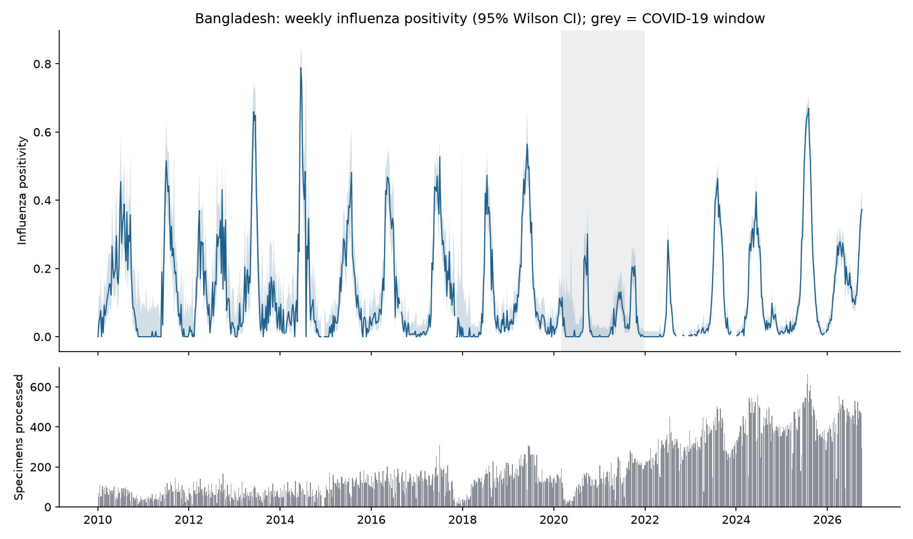
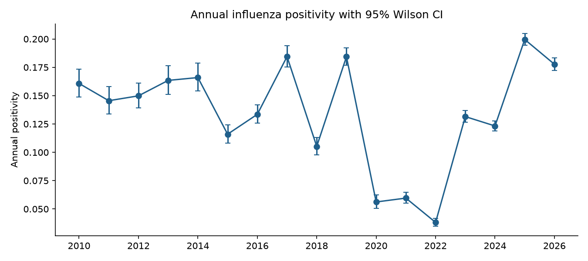
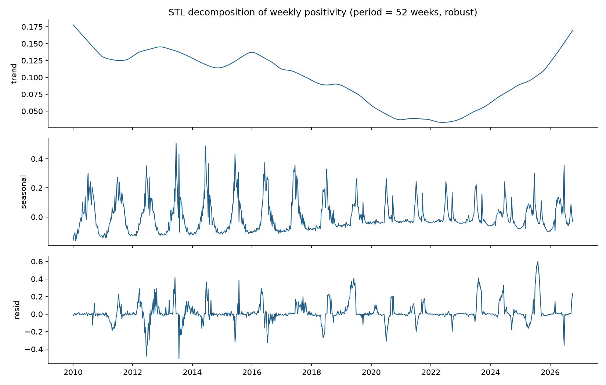
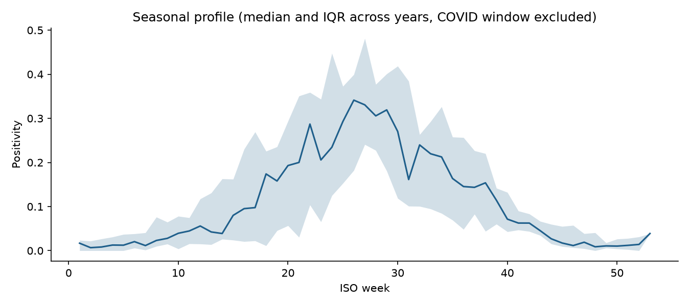
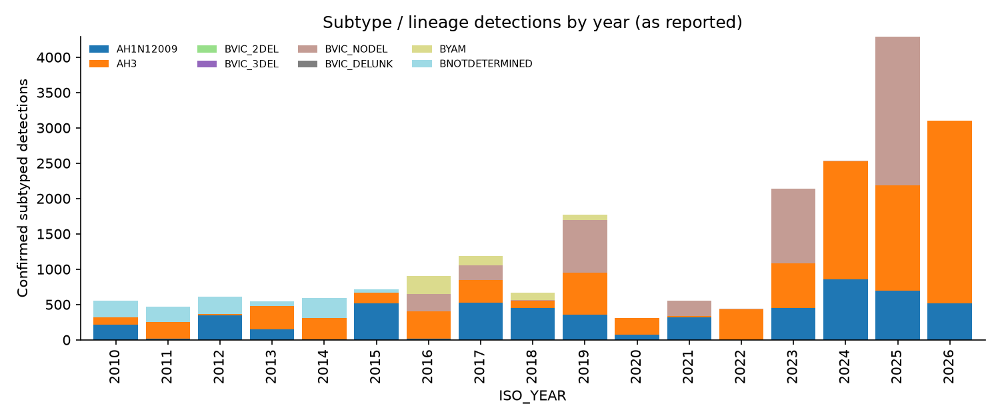
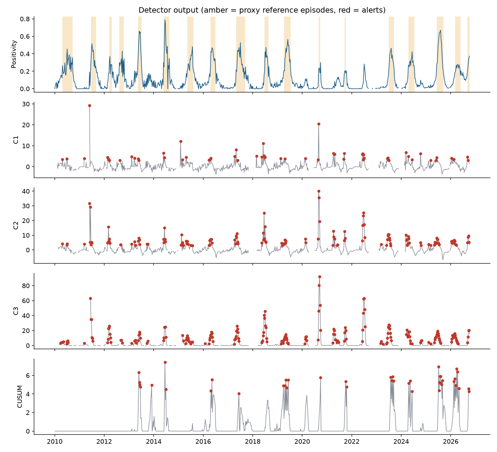

# PathogenWatch BD: Influenza Surveillance Analysis, Bangladesh (WHO FluNet)

_Data: WHO FluNet `VIW_FNT.csv` (SHA-256 `d64afbf5f338822e...`), Bangladesh, ISO weeks 2010-01-04 to 2026-10-05. All numbers below are produced by the pipeline; nothing is hand-entered._

## 1. Objective

Quantify weekly influenza positivity in Bangladesh, characterise its seasonality, and evaluate prospective aberration-detection algorithms (EARS C1/C2/C3 and a seasonal-baseline CUSUM), with transparent assumptions.

## 2. Data and methods

- **Cleaning:** exact duplicates removed; `INF_ALL` recovered from `INF_A + INF_B`; one row per country-week via the documented source policy (see data quality report). Raw data untouched.
- **Positivity** = `INF_ALL / SPEC_PROCESSED_NB`, undefined where nothing was processed; 95% Wilson intervals. Annual positivity uses only weeks where numerator and denominator are both valid.
- **Seasonality:** quasi-binomial GLM with 2 annual harmonics (dispersion = Pearson chi2/df); quasi-F test; robust STL (period 52); Kruskal-Wallis across calendar months. The COVID-19 window (2020-03-01 to 2021-12-31) is excluded from seasonal model *fitting*, because mean annual positivity fell to about one third of its pre-pandemic level then (section 3).
- **Detectors (all prospective, using data up to week t only):** EARS C1/C2/C3 on positivity (7-week baseline, 2-week guard for C2/C3, z > 3; C3 sum > 2), with SD floored at the binomial sampling SD; CUSUM (k = 0.5, h = 4, reset after alarm) on dispersion-corrected Pearson residuals from the harmonic GLM, refit every 26 weeks on past data only (min. 156 weeks training). Weeks with < 30 processed specimens are not scored.
- **Evaluation:** (A) real data against *proxy* reference episodes; (B) semi-synthetic simulation with injected outbreaks. See section 5 for why.

## 3. Descriptive results

Mean annual positivity: 0.151 (2010-2019), 0.051 (2020-2022), 0.158 (2023 onward).

| ISO_YEAR | weeks_valid | processed | influenza_positive | positivity | pos_lo | pos_hi | share_A | share_B |
|---|---|---|---|---|---|---|---|---|
| 2010 | 52 | 3471.000 | 558.000 | 0.161 | 0.149 | 0.173 | 0.565 | 0.435 |
| 2011 | 52 | 3195.000 | 465.000 | 0.146 | 0.134 | 0.158 | 0.535 | 0.465 |
| 2012 | 52 | 4078.000 | 611.000 | 0.150 | 0.139 | 0.161 | 0.597 | 0.403 |
| 2013 | 52 | 3322.000 | 543.000 | 0.163 | 0.151 | 0.176 | 0.880 | 0.120 |
| 2014 | 48 | 3543.000 | 588.000 | 0.166 | 0.154 | 0.179 | 0.529 | 0.471 |
| 2015 | 53 | 6199.000 | 719.000 | 0.116 | 0.108 | 0.124 | 0.925 | 0.075 |
| 2016 | 51 | 6793.000 | 907.000 | 0.134 | 0.126 | 0.142 | 0.444 | 0.556 |
| 2017 | 51 | 6457.000 | 1191.000 | 0.184 | 0.175 | 0.194 | 0.709 | 0.291 |
| 2018 | 52 | 6397.000 | 673.000 | 0.105 | 0.098 | 0.113 | 0.834 | 0.166 |
| 2019 | 52 | 9673.000 | 1783.000 | 0.184 | 0.177 | 0.192 | 0.541 | 0.459 |
| 2020 | 53 | 5534.000 | 311.000 | 0.056 | 0.050 | 0.063 | 0.997 | 0.003 |
| 2021 | 52 | 9310.000 | 555.000 | 0.060 | 0.055 | 0.065 | 0.611 | 0.389 |
| 2022 | 41 | 11573.000 | 442.000 | 0.038 | 0.035 | 0.042 | 0.982 | 0.018 |
| 2023 | 47 | 16294.000 | 2143.000 | 0.132 | 0.126 | 0.137 | 0.507 | 0.493 |
| 2024 | 50 | 20550.000 | 2533.000 | 0.123 | 0.119 | 0.128 | 0.998 | 0.002 |
| 2025 | 51 | 21546.000 | 4300.000 | 0.200 | 0.194 | 0.205 | 0.509 | 0.491 |
| 2026 | 41 | 17496.000 | 3109.000 | 0.178 | 0.172 | 0.183 | 0.999 | 0.001 |

Kendall trend test on annual positivity: all years tau = -0.07 (p = 0.72, n = 17); 2010-2019 tau = 0.07 (p = 0.86, n = 10). With so few annual points, absence of a significant monotone trend is weak evidence of stability. The 2020-2022 dip makes a monotone trend test a poor description of this series.

## 4. Seasonality

- Harmonic model vs intercept-only: quasi-F(4, 749) = 167.6, p = 2.0e-102; dispersion = 19.4 (strongly over-dispersed relative to binomial, as expected when whole epidemic waves vary in size).
- Kruskal-Wallis across months (COVID window excluded): H = 344.9, p = 3.0e-67. Highest median positivity in Jun and Jul.
- Peak ISO week by year (non-COVID years with >= 40 valid weeks): median week 27, range 19-41.

| ISO_YEAR | peak_week | peak_positivity | valid_weeks |
|---|---|---|---|
| 2010 | 27 | 0.455 | 52 |
| 2011 | 27 | 0.516 | 52 |
| 2012 | 39 | 0.431 | 52 |
| 2013 | 23 | 0.660 | 52 |
| 2014 | 25 | 0.788 | 48 |
| 2015 | 31 | 0.481 | 53 |
| 2016 | 19 | 0.468 | 51 |
| 2017 | 27 | 0.528 | 51 |
| 2018 | 29 | 0.473 | 52 |
| 2019 | 23 | 0.565 | 52 |
| 2020 | 40 | 0.302 | 53 |
| 2021 | 41 | 0.207 | 52 |
| 2022 | 27 | 0.283 | 41 |
| 2023 | 32 | 0.464 | 47 |
| 2024 | 24 | 0.424 | 50 |
| 2025 | 32 | 0.670 | 51 |
| 2026 | 41 | 0.373 | 41 |

## 5. Anomaly detection evaluation

**The dataset contains no labelled outbreaks, so true sensitivity and detection delay cannot be measured from it directly.** Two designs are used and must not be confused:

### 5A. Real data vs proxy reference episodes

Proxy episodes = contiguous periods (>= 3 weeks, gaps <= 2 weeks merged) where 3-week centred-median positivity >= 0.192 (75th percentile of non-COVID weeks). This is a retrospective, level-based definition: **not** an outbreak ground truth. A negative delay means the alert fired before the threshold-crossing 'onset' (i.e. during the rise). Alerts outside episodes are called 'false' only relative to this proxy; some may be genuine early rises or noise in low-testing weeks. The ongoing episode at the end of the data is excluded (right-censored).

| detector | episodes_evaluated | episodes_detected_by_peak | sensitivity | median_delay_weeks_from_onset | mean_delay_weeks | alerts_outside_episodes | weeks_outside_episodes | false_alert_rate_per_52wk |
|---|---|---|---|---|---|---|---|---|
| C1 | 13 | 12 | 0.92 | -1.00 | -0.67 | 27 | 516 | 2.72 |
| C2 | 13 | 13 | 1.00 | -2.00 | -1.31 | 51 | 516 | 5.14 |
| C3 | 13 | 13 | 1.00 | -2.00 | -1.46 | 73 | 516 | 7.36 |
| CUSUM | 13 | 8 | 0.62 | 1.50 | 1.62 | 6 | 516 | 0.60 |

Evaluation window starts 2012-12-31 (693 scored weeks, common to all detectors). With only 13 proxy episodes, sensitivities have wide uncertainty (one episode = 8 percentage points).

### 5B. Semi-synthetic simulation

Baseline series are simulated from the fitted seasonal model over 2023-2025 using observed weekly testing volumes, with beta-binomial over-dispersion (rho = 0.047, from the fitted dispersion). Outbreaks are injected as a 4-week ramp then 4-week plateau on the odds scale (odds ratio 1.5, 2, 3) at random start weeks; a detection counts if the first alert falls within 8 weeks of start. 300 replicates per scenario, seed 20261020. **These are properties of the simulation, not of Bangladesh outbreaks.** The CUSUM here uses the true generating seasonal curve as its baseline, so its simulated performance is optimistic compared with real use, where the baseline must be estimated.

False alerts per 52 weeks with no outbreak:

| detector | false_alerts_per_52wk |
|---|---|
| C1 | 2.89 |
| C2 | 4.37 |
| C3 | 8.45 |
| CUSUM | 0.41 |

Sensitivity and delay with injected outbreaks:

| scenario | detector | sensitivity | median_delay_weeks |
|---|---|---|---|
| outbreak OR=1.5 | C1 | 0.42 | 2.00 |
| outbreak OR=1.5 | C2 | 0.48 | 2.00 |
| outbreak OR=1.5 | C3 | 0.56 | 2.00 |
| outbreak OR=1.5 | CUSUM | 0.35 | 5.00 |
| outbreak OR=2.0 | C1 | 0.50 | 2.00 |
| outbreak OR=2.0 | C2 | 0.58 | 2.00 |
| outbreak OR=2.0 | C3 | 0.69 | 1.00 |
| outbreak OR=2.0 | CUSUM | 0.72 | 4.00 |
| outbreak OR=3.0 | C1 | 0.53 | 2.00 |
| outbreak OR=3.0 | C2 | 0.55 | 2.00 |
| outbreak OR=3.0 | C3 | 0.62 | 1.00 |
| outbreak OR=3.0 | CUSUM | 0.88 | 3.00 |

## 6. Interpretation (limited to what the numbers support)

- Influenza in Bangladesh is strongly seasonal in this dataset, with the main activity period in the middle of the year (highest medians Jun/Jul).
- The EARS detectors on positivity flag most proxy episodes early but at a high alert rate outside episodes; the C3 variant is the most alert-prone. Under the simulation, EARS false-alert rates (several per year) would be operationally burdensome without alert filtering (e.g. requiring two consecutive alerts).
- The seasonal CUSUM produced the lowest false-alert rate on real data (0.60 per 52 weeks for CUSUM) but missed more proxy episodes and had longer delays: a sensitivity vs. timeliness trade-off. Parameters (k, h) were set a priori, not tuned on this data; tuning on the same data would inflate performance.
- Simulated sensitivity for a small increase (odds ratio 1.5) is modest for every detector (range 0.35-0.56 within 8 weeks), consistent with the sampling noise at the observed testing volumes.

## 6A. Forecasting model evaluation

Models were evaluated using a chronological holdout. The final portion of the time series was kept for testing, with no random shuffling.

### Rolling one-step-ahead backtest

Rolling evaluation uses chronological cutoffs and evaluates predictions over successive 13-week blocks. Previous observed weeks are available when predicting later weeks; this is not a fixed-origin 13-week forecast.

| model | MAE | RMSE | Predictions |
|---|---|---|---|
| baseline_last_week | 11.431 | 22.235 | 260 |
| random_forest | 17.457 | 41.093 | 260 |

Forecast errors are retrospective evaluation results, not a guarantee of future performance. Model choice should consider baseline performance and changes in reporting or testing patterns.

## 7. Limitations

- Proxy reference episodes are not outbreaks; real-data sensitivity/delay/false-alarm figures depend on that definition and on 13 episodes only.
- Reporting source changed from `NOTDEFINED` to `SENTINEL` at the end of 2019 and testing volume grew over time; positivity can shift for non-epidemiological reasons.
- Seasonal GLM excludes the COVID window and assumes a stable seasonal shape; the post-COVID shape may differ (peak weekly positivity 0.67 in 2025 vs a maximum of 0.46 over 2020-2024).
- Simulation assumptions (odds-scale ramp, beta-binomial noise, known baseline for CUSUM) are idealised.
- The final reporting week is provisional and excluded from alerting.
- Multiple testing across weeks is not adjusted; alerts are screening signals, not confirmed outbreaks.

## 8. Reproducibility

`python -m pathogenwatch.pipeline` regenerates every table and figure; random seed 20261020; the raw file checksum is verified on load.
